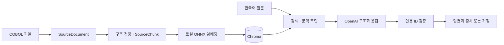

# Legacy Code RAG Backend

**COBOL 코드에 한국어로 질문하고, 파일·문단·청크 출처와 함께 답변을 받는 RAG 백엔드입니다.**

레거시 코드의 처리 흐름과 호출 관계를 파악할 때 필요한 근거를 검색하고, 근거가 부족하거나 인용이 유효하지 않으면 답변을 거절합니다. 코드 수집부터 구조 청킹, 로컬 임베딩, OpenAI 답변 생성, 고정 평가셋 검증과 Docker 실행까지 구현했습니다.

이 프로젝트의 초점은 **코드 근거를 추적할 수 있는 답변, 측정 가능한 품질 개선, 실행 재현성**입니다. 현재 범위는 공개 합성 COBOL을 사용하는 로컬 데모이며, 외부 서버 배포는 포함하지 않습니다.

## 주요 결과

2026-10-27 검증 기록입니다. 공개 합성 **5개 파일·52개 청크**, 고정 **30문항(답변 가능 24개 + 근거 부족 6개)**을 사용했습니다.

| 지표 | 개선 전 | 현재 |
|---|---:|---:|
| 정답·완전성·충분한 인용을 모두 충족 | 13/24 (54.2%) | **15/24 (62.5%)** |
| 근거 부족 질문의 올바른 거절 | 6/6 | **6/6** |
| 전체 기대 동작 충족¹ | 19/30 (63.3%) | **21/30 (70.0%)** |
| 실제 생성 HTTP p50 / p95 | 1.735초 / 5.688초 | 1.630초 / 3.032초 |

¹ 정답·인용 충족과 올바른 거절의 합입니다. 답변 정확도와 거절 성능은 위의 별도 분모로 해석합니다.

**정답·인용 충족률은 약 8.3%p 상승**했습니다. 개선 3건과 회귀 1건을 모두 보존했습니다. 같은 소규모 개발 평가셋을 재사용했고 의미 판정은 Codex의 1차 코드 대조 결과입니다. 독립적인 사람 검수와 별도 평가셋 검증은 아직 완료하지 않았으므로 일반적인 COBOL 질문의 정확도로 해석할 수 없습니다.

- [30문항의 실제 질문·답변·출처·채점 결과](data/evaluation/results/generation-evaluation-v2.json)
- [개선 전후 평가와 실패 분석](docs/generation-evaluation-v2.md)
- Windows 전체 테스트 **186개 통과**. Linux는 실제 Docker 빌드·HTTP 동작·컨테이너 재생성 후 검색 결과 보존을 검증했습니다. Linux 전체 pytest를 실행한 결과는 아닙니다.

## 실제 응답 사례

[5분 대표 데모 진행 가이드](docs/demo.md): 실제 검색 시연과 저장된 생성 응답·코드 근거를 함께 확인하는 순서입니다. 추가 유료 호출 없이 진행할 수 있습니다.

아래는 v2 평가에 저장된 응답을 발췌한 사례입니다. 긴 인용 ID는 표에서 생략했으며 원본 JSON에 보존했습니다. 실시간 데모 결과가 아닙니다.

| 사례 | 질문 | 실제 응답 또는 상태 | 코드 근거 |
|---|---|---|---|
| 문단 탐색 · q001 | 고객 입력 파일을 여는 문단은 무엇인가? | 고객 입력 파일을 여는 문단은 `OPEN-FILES`이며, `OPEN INPUT CUSTOMER-IN`으로 엽니다. | `customer-import.cbl`의 `OPEN-FILES` |
| 호출 관계 · q014 | TRANSACTION-POST가 잔액 계산을 위해 호출하는 프로그램은 무엇인가? | TRANSACTION-POST는 잔액 계산을 위해 ACCOUNT-BALANCE 프로그램을 호출합니다. | `transaction-post.cbl`의 `POST-TRANSACTIONS` |
| 근거 부족 · q025 | 이 샘플에서 DB2 고객 테이블을 갱신하는 SQL 문은 무엇인가? | `refused / insufficient_evidence`, 답변 없음 | 해당 기능의 근거 없음 |

## 처리 구조와 기술 선택



| 영역 | 구현과 선택 이유 |
|---|---|
| API · Python / FastAPI | 색인·검색·질의 계약을 분리하고 OpenAPI 문서 제공 |
| 수집·청킹 | COBOL division·section·paragraph 경계를 활용하고 원문과 심볼 메타데이터 보존. 행 번호 형식의 경계 판별 지원 |
| 임베딩 · ONNX Runtime | 다국어 MiniLM을 CPU에서 로컬 실행. 한국어 질문과 COBOL 식별자를 함께 검색 |
| 검색 · Chroma | 로컬 영속 저장소와 프로필별 collection으로 기준선·개선 결과 분리 |
| 생성 · OpenAI Responses API | 구조화된 주장과 인용을 반환받아 실제 제공한 청크 ID인지 재검증. 기본 생성 비활성화 |
| 평가 · pytest / 고정 평가셋 | 검색 근거 확보와 실제 답변 품질을 분리하고 실패·회귀 사례까지 기록 |
| 운영 · Docker Compose | 비root 실행, 읽기 전용 모델·샘플, 전용 영속 볼륨, 상태 검사와 제한된 요청 로그 |

문맥은 최대 10개 청크·원문 4,000자로 제한합니다. 출처에는 `chunk_id`, `source_path`, `symbol` 등을 보존합니다. 인용 ID가 유효하다는 사실만으로 답변의 의미적 정확성을 보장하지 않으므로, 별도의 코드 대조 평가를 수행했습니다.

```text
src/legacy_rag/
├── api/          # HTTP 계약·설정·의존성 주입
├── ingestion/    # 파일 로딩·구조 청킹·메타데이터
├── retrieval/    # 임베딩·Chroma·검색 정책
├── generation/   # 공급자 어댑터·근거 기반 답변 계약
└── evaluation/   # 고정 평가셋·지표·평가 실행
tests/            # 단위·통합 테스트
data/evaluation/  # 공개 질문·근거·rubric·버전별 결과
docs/             # 설계·실험·운영 기록
```

상세한 경계와 의존 방향은 [아키텍처](docs/architecture.md)를 참고하세요.

## 개선 과정과 실패에서 배운 점

**검색 실패 위치를 확인한 뒤 식별자 표현을 보완했습니다.** 누락 근거가 검색 순위 11~48위에 있는 사례를 확인했습니다. 원래 표현과 식별자의 하이픈·밑줄을 단어 경계로 정규화한 표현의 임베딩을 동일 비중으로 결합하고 L2 정규화했습니다. 모델을 추가하지 않고, 무료 검색 검증의 근거 확보를 **13/24 → 16/24**로 개선했습니다.

이 수치는 실제 답변의 **15/24**와 다릅니다. q002는 재구성한 검색 문맥에 필요한 근거가 있어도 최종 응답이 `invalid_citations`로 거절된 회귀 사례입니다. 거절 전 모델 출력은 수집하지 않아 잘못된 인용의 세부 원인은 확정하지 않았습니다. 답변 가능한 24문항 중 최종 답변을 제공하지 못한 9문항도 실패에 포함했습니다.

행 번호 COBOL은 경계 판별 입력만 보정하고 저장 원문은 유지했습니다. 기존 공개 52개 청크와 30문항 검색 문맥이 바뀌지 않음을 확인했습니다. 로컬 추가 평가에서는 개선과 일부 검색 지표 하락이 함께 관측됐으며 비공개 자료는 공개 결과에 포함하지 않았습니다.

- [식별자 표현 보완과 전후 비교](docs/identifier-aware-retrieval-v1.md)
- [행 번호 COBOL 호환성과 회귀 검증](docs/numbered-cobol-chunking.md)
- [후보 확대·로컬 재순위화 실험](docs/retrieval-candidates.md): 근거 확보16/24→22/24, 기존 성공 회귀0. CPU 재순위화 p50 28.27초로 기본 적용 보류. 실제 답변 정확도와 구분합니다.
- 이전 실험: [구조 청킹](docs/structured-chunking-baseline.md) · [문맥화](docs/contextual-embedding-baseline.md) · [다국어 모델](docs/multilingual-embedding-baseline.md) · [관계 확장](docs/context-expansion-baseline.md) · [창 평균](docs/windowed-embedding-baseline.md)

## 빠른 시작 — 로컬 검색 데모

Python 3.11과 Docker Desktop의 Linux 엔진이 필요합니다. 아래 명령은 저장소 루트의 **PowerShell**에서 실행합니다. 기본 실행에는 OpenAI 키가 필요하지 않으며 생성 API를 호출하지 않습니다.

### 1. 의존성과 임베딩 모델 준비

```powershell
py -3.11 -m venv .venv
.\.venv\Scripts\python.exe -m pip install -e ".[dev,evaluation,openai]"
```

API는 모델을 자동 다운로드하지 않습니다. 다음 명령으로 고정 revision의 공개 모델 파일을 준비합니다. 최초 다운로드는 약 480MB이며 외부 생성 API 호출은 없습니다. 같은 캐시가 있다면 재사용합니다.

```powershell
.\.venv\Scripts\python.exe -c "from huggingface_hub import snapshot_download; from legacy_rag.evaluation.multilingual_embedding import MODEL_ID, MODEL_REVISION, MODEL_FILES; print(snapshot_download(MODEL_ID, revision=MODEL_REVISION, allow_patterns=list(MODEL_FILES), cache_dir='data/models', token=False, max_workers=2))"
```

모델은 `sentence-transformers/paraphrase-multilingual-MiniLM-L12-v2`, revision은 `e8f8c211226b894fcb81acc59f3b34ba3efd5f42`입니다. 다른 snapshot 경로를 사용하려면 `LEGACY_RAG_RUNTIME_MODEL_DIR`에 지정합니다.

### 2. Docker 실행과 공개 샘플 색인

```powershell
docker compose -f compose.yaml config --quiet
docker compose -f compose.yaml build
docker compose -f compose.yaml up -d --no-build
Invoke-RestMethod http://127.0.0.1:8001/health
.\.venv\Scripts\python.exe -X utf8 scripts/verify_runtime.py --index --output artifacts/readme-runtime-before.json
```

컨테이너 기동 후 상태·색인 검사를 실행합니다. 검증 도구는 공개 5개 파일을 색인하고 준비 상태와 검색을 검사합니다. 성공 시 `retrieval_ok`를 출력합니다. 출력 파일이 이미 있으면 덮어쓰지 않고 중단하므로 재실행할 때는 새 파일명을 사용합니다.

OpenAPI 문서: **http://127.0.0.1:8001/docs**

```powershell
$ragSearchBody = @{ query = "잔액을 계산하는 프로그램은 무엇인가?"; limit = 3 } | ConvertTo-Json
Invoke-RestMethod -Method Post -Uri http://127.0.0.1:8001/search -ContentType "application/json; charset=utf-8" -Body ([System.Text.Encoding]::UTF8.GetBytes($ragSearchBody))
```

### 3. 컨테이너 재생성 후 검색 결과 보존 확인

```powershell
docker compose -f compose.yaml up -d --no-build --no-deps --force-recreate api
.\.venv\Scripts\python.exe -X utf8 scripts/verify_runtime.py --compare artifacts/readme-runtime-before.json --output artifacts/readme-runtime-after.json
```

컨테이너 기동 후 검증 도구를 실행합니다. 재색인 없이 같은 검색의 상위 10개 청크 순서·ID·본문·메타데이터를 비교하며, 성공 시 `persistence_matches=True`를 출력합니다. 전체 DB 백업 검증은 아닙니다. 중지할 때는 `docker compose -f compose.yaml stop api`를 사용합니다.

### 선택: Docker 없이 API 실행

의존성과 모델 준비 후 다음 명령을 사용합니다. Docker의 전용 볼륨과 별개인 호스트 `data/chroma/api-v3-identifier-aware/`에 저장합니다.

```powershell
$env:LEGACY_RAG_GENERATION_PROVIDER = "disabled"
.\.venv\Scripts\python.exe -m uvicorn legacy_rag.main:app --host 127.0.0.1 --port 8000 --no-access-log --log-config logging.json
```

다른 터미널에서 `http://127.0.0.1:8000/docs`를 열어 공개 샘플을 `/documents/index`로 색인한 뒤 검색합니다. 데이터 루트·저장소·모델 경로는 [.env.example](.env.example)을 참고하세요. 앱은 `.env`를 자동 로드하지 않으며 환경변수 변경 후 서버 재시작이 필요합니다.

## 답변 생성과 API

| API | 역할 |
|---|---|
| `GET /health` | 프로세스 상태 확인 |
| `GET /ready` | 실제 로컬 검색과 비어 있지 않은 색인 확인. OpenAI 준비 검사는 아님 |
| `POST /documents/index` | 데이터 루트 기준 상대 경로의 파일 색인 |
| `POST /search` | 관련 코드 청크·출처·점수 반환 |
| `POST /query` | 근거 기반 답변 또는 `refused` / `unavailable` 반환 |

기본 생성 비활성화 상태에서는 문맥이 있어도 `/query`가 `unavailable / generation_unavailable`을 반환합니다. 실제 OpenAI 생성에는 서버 환경변수의 키와 공급자 설정이 필요하며 비용이 발생합니다. [OpenAI 연결 안내](docs/openai-generation.md)와 [Docker 선택 구성](docs/runtime.md#선택적-openai-연결)을 따르세요. 평가 당시 설정 모델은 `gpt-6-luna`입니다.

OpenAI 모드에서는 승인된 공개 합성 5개 파일의 경로·해시와 생성 직전 청크 내용을 대조합니다. 로컬 전용 COBOL은 외부 생성 입력에서 제외합니다. 질문 본문의 일반 민감정보 탐지·마스킹은 구현하지 않았습니다.

## 테스트와 운영 검증

```powershell
$env:LEGACY_RAG_GENERATION_PROVIDER = "disabled"
.\.venv\Scripts\python.exe -m pytest -q
```

테스트는 가짜 응답과 MockTransport를 사용하며 실제 OpenAI 호출이 필요하지 않습니다. 테스트 통과와 실제 답변 품질 평가는 별개입니다.

| 검증 항목 | 2026-10-27 관측 결과 |
|---|---|
| Windows 테스트 | 186 passed |
| Linux Docker | 이미지 빌드·실제 HTTP·컨테이너 재생성 검증 완료 |
| 최초 색인 | 5개 파일·52청크, 초기화 포함 20.459초 |
| 재생성 후 warm 검색 | p50 0.030초 / p95 0.039초, 같은 질문 순차 10회 |
| 영속성 | 재색인 없이 상위 10청크 해시 일치 |
| 기본 실행 보호 | UID10001, 읽기 전용 rootfs·모델·샘플, loopback 바인딩, 키 미전달 |

검색 지연은 작은 단일 질문 표본이며 동시성 SLA가 아닙니다. 생성 지연과도 구분합니다. 요청 로그에는 서버 생성 ID·상태·지연 등 허용 필드만 남기며 질문·코드·키·원시 예외는 제외합니다.

측정 조건과 장애 계약은 [운영 안내](docs/runtime.md), [Linux 검증 결과](data/evaluation/results/runtime-verification-v2.json), [설치 패키지 목록](data/evaluation/results/runtime-linux-packages-v1.txt)에 기록했습니다. 설치 목록은 관측 snapshot이며 향후 빌드를 고정하는 의존성 lock은 아닙니다.

## 한계와 남은 작업

- **평가:** 합성 5개 파일·개발용 30문항의 결과입니다. 독립 사람 검수, 별도 holdout, 실제 업무 코드의 생성 품질 검증이 남아 있습니다. 실제 토큰 사용량·청구 비용은 측정하지 않았습니다.
- **COBOL 지원:** 구조 경계 기반 청킹이며 완전한 COBOL parser가 아닙니다. 일반 copybook 전개와 전처리·실행 의미 해석은 지원 범위 밖입니다.
- **운영:** 인증·HTTPS·외부 서버 배포·다중 사용자 부하 검증은 미구현입니다. 현재 기본 접속 범위는 같은 PC입니다.
- **데이터 갱신:** 색인은 한 번에 하나만 수행하고 색인 중 검색·질의를 멈춥니다. 갱신은 비원자적이며 자동 롤백·무중단 갱신·자동 백업은 구현하지 않았습니다.
- **제출 마무리:** 대표 데모 촬영, 사용자 직접 실행과 평가 검수, 최종 제출본 점검이 남아 있습니다.

## 관련 문서

- [아키텍처](docs/architecture.md) · [API·답변 계약](docs/grounded-query-contract.md)
- [평가 질문](data/evaluation/questions-v1.jsonl) · [코드 근거](data/evaluation/evidence-v1.jsonl) · [채점 기준](data/evaluation/answer-rubric-v1.jsonl)
- [개선 전 생성 평가](docs/generation-evaluation-v1.md) · [개선 후 생성 평가](docs/generation-evaluation-v2.md)
- [데이터 반입 규칙](data/README.md) · [단계별 개발 기록](docs/roadmap.md)

비공개 원문·로컬 평가 자료·API 키·모델 캐시·Chroma 저장소는 공개 저장소에 포함하지 않습니다.
